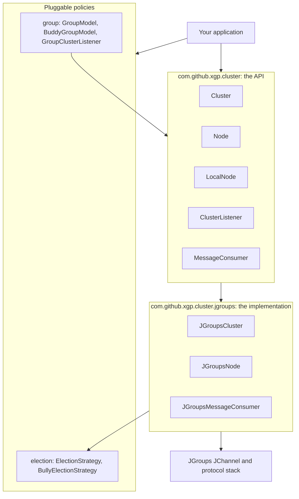
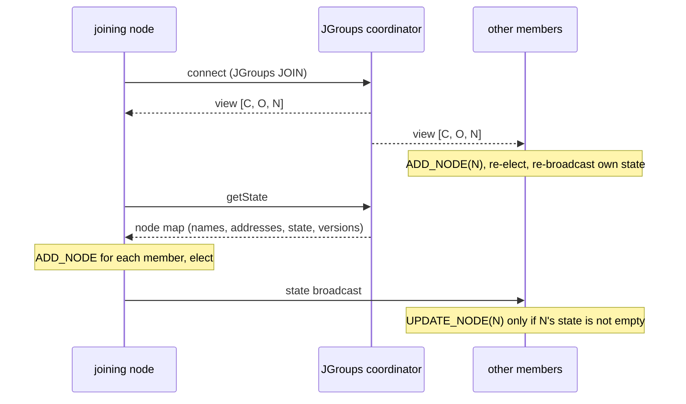

# ActiveCluster architecture

This document explains how the JGroups implementation turns JGroups' group-membership and
reliable-messaging primitives into the ActiveCluster model of named nodes, replicated state,
events, messaging and an elected coordinator. Read the [README](../README.md) first for the API.

## Layers



- **API.** Interfaces with no JGroups types in them. Another transport could implement them.
- **Policies.** `ElectionStrategy` decides the coordinator. The `group` package arranges members
  into master/buddy groups from cluster events; it is pure in-memory logic.
- **Implementation.** `JGroupsCluster` is one JGroups `JChannel` plus the bookkeeping described
  below. It is the JGroups `Receiver` for views, messages and state transfer.

## Identity

A member is identified by its **name**, which must be unique in the cluster and differ from the
cluster name. `JGroupsDestination` equality is by name only. The JGroups `Address` of a member is
carried alongside as a transient field because it changes every time the member restarts.

The JGroups channel is given the node name as its logical name. Peers learn the mapping from
address to name from JGroups discovery (the `NameCache`), from state transfer, and from each
member's state broadcasts, which carry its name.

## Lifecycle

**Start.**

1. Create the channel from the configured stack. A named stack that fails to load fails `start()`;
   nothing is substituted.
2. Mark the member started, then `connect()`. The first view arrives during `connect()` and is
   processed like any other.
3. If other members exist, request **state transfer**. The coordinator of the JGroups view returns
   a copy of its node map: every member's name, address, state and state version.
4. Re-apply the current view (a no-op unless the connect-time callback was missed) and
   **broadcast this member's state**.

**Stop.**

1. Close every consumer.
2. Multicast a `LEAVING` notice and wait, at most three seconds, for an acknowledgement from each
   other member. Members that are leaving themselves, or that a newer view has dropped, are not
   waited for.
3. Disconnect and close the channel. Listeners are kept, so a stopped member can start again.



## Membership and events

Membership follows the JGroups **view**. Each new view is diffed against the node map under one
lock, and events are fired in order while that lock is held.

| Situation | Events on every other member |
|---|---|
| A member joins | `ADD_NODE` |
| A member's state or zone changes | `UPDATE_NODE` |
| A member calls `stop()` | `REMOVE_NODE` |
| A member crashes, hangs or becomes unreachable | `FAILED_NODE`, then `REMOVE_NODE` |
| The coordinator changes | `ELECTED_COORDINATOR` |

Rules that hold everywhere:

- No `ADD_NODE`, `UPDATE_NODE`, `REMOVE_NODE` or `FAILED_NODE` is fired about the local member.
- A remote member's `Node` object keeps its identity for as long as it stays in the cluster. The
  object in an event is the object in `getNodes()`.
- A view older than the last one applied is ignored, so views can be re-applied safely.
- A member whose name is not yet known when its view arrives is held back and added when its state
  broadcast (which carries its name) arrives. A state broadcast from an address that is not in the
  current view is held until the view catches up.

**Clean leave versus failure.** JGroups views do not say why a member left. The `LEAVING` notice
sent by `stop()` is recorded by each survivor, and acknowledged, before the departing member
disconnects. When a view drops a member, it is reported as `REMOVE_NODE` if it announced its leave
and as `FAILED_NODE` then `REMOVE_NODE` otherwise.

## Replicated state

Each member owns its state map and zone. `LocalNode.setState` replaces the state, increments the
member's **state version**, re-runs the election locally, and multicasts a detached copy (never the
local node object itself).

Receivers apply a copy only if its version is newer than the one they hold for that member's
current address. A copy from a new address (a restarted member) is always applied. This makes
state propagation idempotent and order-independent. Re-broadcasts, state transfer and merges can
deliver copies late or twice, but they can never roll state back, and an unchanged copy fires no
event.

Members re-broadcast their state whenever a view adds members. The newcomer would get the state
from state transfer anyway; the re-broadcast covers a state change that raced with the transfer,
and it is how state crosses a healed partition.

## Coordinator election

The election runs on every member whenever membership changes or any member's state or zone
changes. Setting a new strategy takes effect at the next such change. It runs over the same node map everywhere, so a deterministic `ElectionStrategy` makes
every member reach the same answer. The winner's `isCoordinator()` flag is set on the shared node
objects, and `ELECTED_COORDINATOR` fires only when the winner's name changes. A listener added
while the cluster is running is told the current coordinator immediately.

The default `BullyElectionStrategy` picks the highest name. This is independent of which member
JGroups uses as its own view coordinator.

The coordinator is **not a lock**. While a network is partitioned, each side elects its own
coordinator. See the next section.

## Messaging

| Send to | JGroups message | Who receives it |
|---|---|---|
| `cluster.getDestination()` | multicast `ObjectMessage` | Every member's cluster-destination consumers, including the sender's own unless the consumer is `noLocal` |
| `node.getDestination()` | unicast `ObjectMessage` to the node's current address | Only that member's local-node-destination consumers |

- A direct send resolves the target's address from the node map at send time. A name that is not
  a current member throws `ClusterException`. The message object is never modified.
- Ordering and reliability come from the JGroups stack: `NAKACK2` gives reliable FIFO multicast per
  sender, `UNICAST3` gives reliable FIFO unicast, and `FRAG2` fragments large messages. Flow control
  (`UFC`, `MFC`) is left enabled.
- The selector supports one property equality, `key='value'` or `key=value`. Anything else is
  rejected when the consumer is created.
- Each consumer and each listener is isolated: an exception is logged and delivery continues to the
  others.

## Network partitions and merges

JGroups detects an unreachable member with its failure-detection protocols (`FD_ALL3`, `FD_SOCK2`,
`VERIFY_SUSPECT`). When the network splits, each side installs a view without the other side, and
heals with a **merge** (`MERGE3`) once the members can reach each other again.

```mermaid
sequenceDiagram
  participant A as node1, node2
  participant B as node3
  Note over A,B: network splits
  Note over A: FAILED_NODE(node3), REMOVE_NODE(node3), coordinator becomes node2
  Note over B: FAILED_NODE(node1, node2), REMOVE_NODE(...), node3 stays coordinator
  Note over A,B: both sides keep working; state may change on both
  Note over A,B: network heals, JGroups MergeView
  Note over A: ADD_NODE(node3)
  Note over B: ADD_NODE(node1), ADD_NODE(node2)
  A->>B: state broadcasts (new members in view)
  B->>A: state broadcasts
  Note over A,B: newer versions applied (UPDATE_NODE), one coordinator again
```

What the implementation guarantees, and the tests in `JGroupsPartitionTest` check:

- Each side reports the other as failed and elects a coordinator of its own.
- Both sides keep messaging and changing state independently. Nothing crosses the partition.
- After the merge every member agrees on membership and on a single coordinator. Each returning
  member fires one `ADD_NODE`, and state changed on either side during the partition is visible
  everywhere.
- Repeated splits and merges neither leak members nor duplicate events.

What it does **not** do:

- Prevent **split brain**. During a partition there are two coordinators. Work that must run at
  most once needs a quorum check. For example, act only while `getNodes().size()` is more than
  half of the expected cluster size.
- Merge application data. Node state is per member and always has a single owner, so it never
  conflicts. Application data replicated by your own messages must be reconciled by your
  application, for example in response to `ADD_NODE` after a merge.

## Threading and locking

- Events and messages are delivered on JGroups threads. A slow callback delays further deliveries
  from the same sender, so hand long work to your own executor.
- Cluster events are fired while the node map lock is held, which keeps them in order and
  consistent with `getNodes()`. Do not call `start()` or `stop()` from a callback.
- `getNodes()` returns a snapshot map; the `Node` values are live and thread-safe to read.
- A message object is shared with this member's own consumers when it is looped back. Do not
  modify a message after sending it.

## Wire format

All payloads use Java serialization, inside JGroups messages.

| Payload | JGroups message | Purpose |
|---|---|---|
| `JGroupsMessage` | `ObjectMessage`, multicast or unicast | Application messages |
| `ClusterEvent(UPDATE_NODE, JGroupsNode)` | `BytesMessage`, multicast, not looped back | State broadcast: name, address, state, zone, version |
| `ControlMessage(LEAVING)` | `ObjectMessage`, multicast | Clean-leave notice |
| `ControlMessage(LEAVE_ACK)` | `ObjectMessage`, unicast | Acknowledgement of a leave notice |
| node count, then `JGroupsNode`s | state-transfer stream | Node map for a joining member |

Because Java deserialization runs on data from any member, run clusters only on networks you trust,
and consider the JGroups `ENCRYPT` and `AUTH` protocols and a JVM-wide `jdk.serialFilter`.

## Tests

| Tier | How to run | What it covers |
|---|---|---|
| Unit | `mvn test` | Serialization, selectors, group models, election rules |
| In-JVM cluster | `mvn test` | Lifecycle, membership, messaging, state, election, partitions, over JGroups `SHARED_LOOPBACK` |
| Real TCP, one JVM | `mvn test` | One full scenario over TCP on 127.0.0.1 |
| Separate JVMs | `mvn verify -Pmultiprocess` | The example app in three processes, driven through stdin |

Partitions are simulated with the JGroups `DISCARD` protocol (`src/test/resources/test-partition.xml`).
`ReadmeExamplesTest` compiles and runs the README's code samples.
